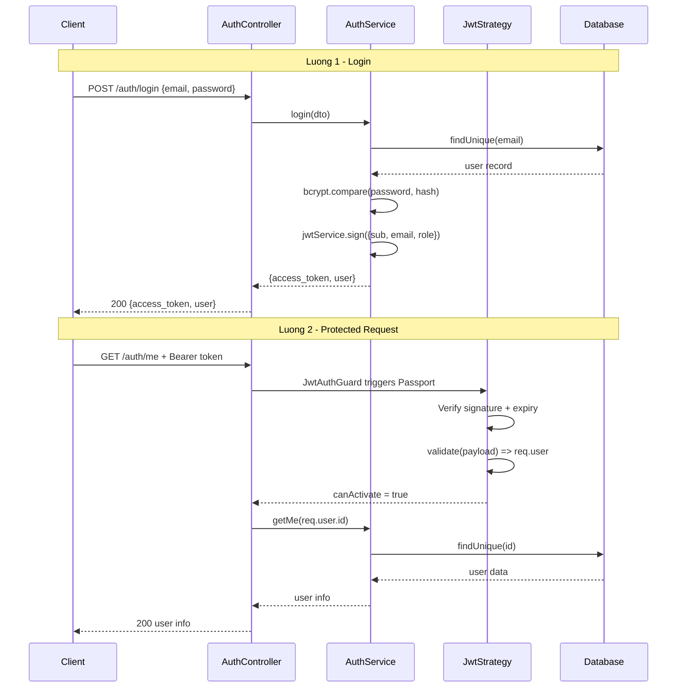

# Visual Explanation: JWT Authentication Flow in NestJS

## Overview

Hệ thống dùng **JWT (JSON Web Token)** kết hợp với **Passport.js** để xác thực request.
Có 2 luồng chính: **Login** (lấy token) và **Protected Request** (dùng token để truy cập).

---

## Luồng 1: Login — Lấy Token

```
Client                  AuthController          AuthService             Database
  │                          │                       │                      │
  │  POST /auth/login         │                       │                      │
  │  { email, password }      │                       │                      │
  │──────────────────────────>│                       │                      │
  │                          │  authService.login()   │                      │
  │                          │───────────────────────>│                      │
  │                          │                       │  findUnique(email)    │
  │                          │                       │─────────────────────>│
  │                          │                       │  user hoặc null       │
  │                          │                       │<─────────────────────│
  │                          │                       │                      │
  │                          │                       │  bcrypt.compare()     │
  │                          │                       │  (password vs hash)   │
  │                          │                       │                      │
  │                          │                       │  jwtService.sign()    │
  │                          │                       │  payload = {          │
  │                          │                       │    sub: user.id,      │
  │                          │                       │    email,             │
  │                          │                       │    role               │
  │                          │                       │  }                    │
  │                          │                       │                      │
  │  { access_token, user }   │                       │                      │
  │<──────────────────────────│                       │                      │
```

---

## Luồng 2: Protected Request — Dùng Token

```
Client                JwtAuthGuard          JwtStrategy            Controller
  │                       │                      │                      │
  │  GET /auth/me          │                      │                      │
  │  Header:               │                      │                      │
  │  Authorization:        │                      │                      │
  │  Bearer <token>        │                      │                      │
  │───────────────────────>│                      │                      │
  │                       │  AuthGuard('jwt')     │                      │
  │                       │  kích hoạt Passport   │                      │
  │                       │─────────────────────>│                      │
  │                       │                      │  Đọc token từ Header  │
  │                       │                      │  Verify chữ ký        │
  │                       │                      │  (JWT_SECRET)         │
  │                       │                      │  Kiểm tra expiry      │
  │                       │                      │                      │
  │                       │                      │  validate(payload)    │
  │                       │                      │  → gán vào req.user   │
  │                       │                      │  { id, email, role }  │
  │                       │                      │                      │
  │                       │  canActivate = true  │                      │
  │                       │<─────────────────────│                      │
  │                       │                                             │
  │                       │─────────────────────────────────────────>  │
  │                                                                     │
  │  @CurrentUser() → req.user                                          │
  │  authService.getMe(user.id)                                         │
  │<────────────────────────────────────────────────────────────────────│
```

---

## Luồng 3: Role-Based Access — Phân Quyền

```
Request với JWT token
         │
         ▼
┌─────────────────┐     token hợp lệ      ┌─────────────────┐
│  JwtAuthGuard   │──────────────────────>│   RolesGuard    │
│                 │                        │                 │
│ Verify JWT      │     token lỗi → 401   │ Đọc @Roles()    │
│ Gán req.user    │<──────────────────────│ decorator       │
└─────────────────┘                        │                 │
                                           │ So sánh         │
                                           │ req.user.role   │
                                           │ vs requiredRoles│
                                           └────────┬────────┘
                                                    │
                              ┌─────────────────────┴──────────────────────┐
                              │                                             │
                    role khớp → 200 OK                          role không khớp → 403
                    vào Controller                               Forbidden
```

---

## Sơ đồ tổng quan (Mermaid)



---

## Giải thích từng thành phần trong code

### `auth.module.ts` — Đăng ký JWT

```typescript
JwtModule.register({
  secret: process.env.JWT_SECRET ?? 'fallback-secret',
  signOptions: { expiresIn: '7d' },  // Token hết hạn sau 7 ngày
})
```

- `JwtModule` cung cấp `JwtService` (dùng để `sign` và `verify` token)
- `PassportModule` kích hoạt hệ thống strategy của Passport.js
- `JwtStrategy` được đăng ký như một provider → Passport tự nhận

---

### `jwt.strategy.ts` — Xử lý khi request đến

```typescript
// Cấu hình: đọc token từ header Authorization: Bearer <token>
jwtFromRequest: ExtractJwt.fromAuthHeaderAsBearerToken()

// validate() chạy SAU KHI Passport đã verify chữ ký và expiry
async validate(payload: JwtPayload) {
  return { id: payload.sub, email: payload.email, role: payload.role };
  // Kết quả này được gán vào req.user
}
```

**Quan trọng:** `validate()` KHÔNG cần query DB nữa — mọi thông tin cần thiết (`id`, `email`, `role`) đã có trong payload. Passport đã verify chữ ký bằng `JWT_SECRET` nên dữ liệu đáng tin.

---

### `jwt-auth.guard.ts` — Bảo vệ route

```typescript
export class JwtAuthGuard extends AuthGuard('jwt') {}
```

Cực kỳ đơn giản. `AuthGuard('jwt')` là NestJS wrapper tự động:
1. Gọi `JwtStrategy` để extract và verify token
2. Gán kết quả `validate()` vào `req.user`
3. Nếu token lỗi → tự throw `UnauthorizedException (401)`

Dùng bằng `@UseGuards(JwtAuthGuard)` trên controller hoặc method.

---

### `roles.guard.ts` — Phân quyền theo role

```typescript
const requiredRoles = this.reflector.getAllAndOverride<UserRole[]>(ROLES_KEY, [
  context.getHandler(),  // đọc @Roles() trên method
  context.getClass(),    // hoặc trên class
]);

const { user } = context.switchToHttp().getRequest();
return requiredRoles.includes(user?.role);  // so sánh role
```

`RolesGuard` luôn chạy SAU `JwtAuthGuard` (vì cần `req.user` đã được gán).
Nếu không có `@Roles()` decorator → cho qua hết (return true).

---

### `current-user.decorator.ts` — Lấy user từ request

```typescript
// Thay vì viết:
@Get('me')
getMe(@Req() req: Request) {
  const userId = req.user.id;  // verbose
}

// Dùng decorator gọn hơn:
@Get('me')
getMe(@CurrentUser() user: { id: string }) {
  return this.authService.getMe(user.id);  // clean
}
```

---

### `auth.service.ts` — Logic login

```typescript
// Bước 1: tìm user theo email
const user = await this.prisma.user.findUnique({ where: { email } });

// Bước 2: verify password (bcrypt so sánh plain vs hash)
const passwordValid = await bcrypt.compare(dto.password, user.passwordHash);

// Bước 3: kiểm tra account active
if (user.status === 'INACTIVE') throw new ForbiddenException(...)

// Bước 4: tạo token
const payload = { sub: user.id, email: user.email, role: user.role };
const access_token = this.jwtService.sign(payload);
```

Cả email-not-found và password-wrong đều trả về **cùng một message** `'Invalid credentials'` để tránh user enumeration (attacker không biết email có tồn tại không).

---

## Token Structure

```
eyJhbGciOiJIUzI1NiIsInR5cCI6IkpXVCJ9   ← Header (algorithm)
.
eyJzdWIiOiJ1c2VyX2lkIiwiZW1haWwiOi...   ← Payload (data)
.
SflKxwRJSMeKKF2QT4fwpMeJf36POk6yJV...   ← Signature (verify)
```

Payload sau khi decode:
```json
{
  "sub": "clxxxxxxxxxxxxxxx",   ← user.id (CUID)
  "email": "owner@example.com",
  "role": "OWNER",
  "iat": 1742567000,            ← issued at
  "exp": 1743176600             ← expires at (iat + 7d)
}
```

---

## Key Points

1. **Stateless** — Server không lưu token. Mỗi request tự mang thông tin trong token.
2. **`validate()` không query DB** — Nhanh hơn, không tốn DB call cho mỗi request.
3. **`JwtAuthGuard` trước, `RolesGuard` sau** — Thứ tự guard quan trọng.
4. **`JWT_SECRET` phải bảo mật** — Ai có secret này có thể tạo token giả.
5. **Token expiry 7d** — Hết hạn phải login lại (không có refresh token trong MVP).
